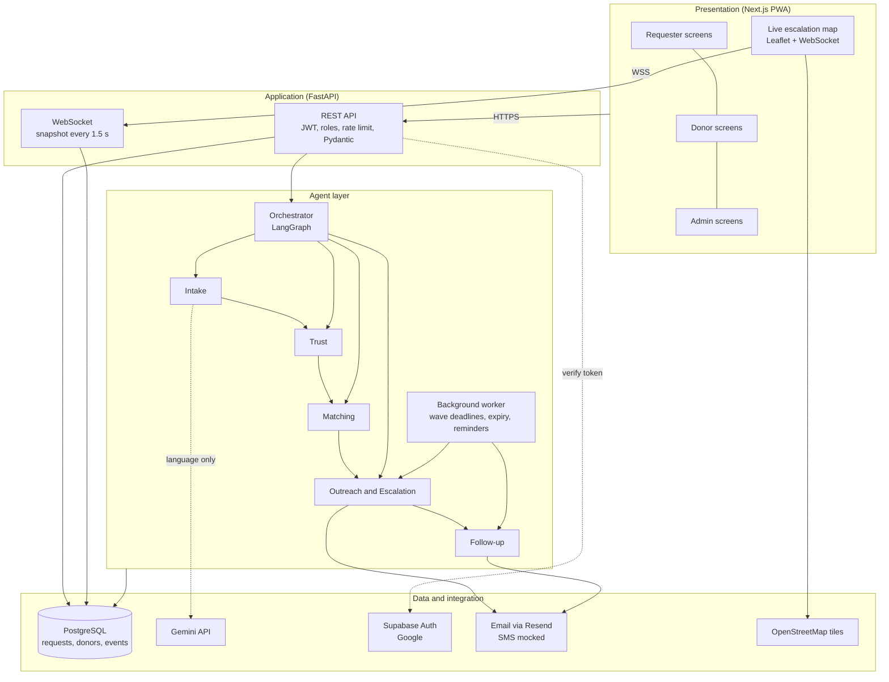
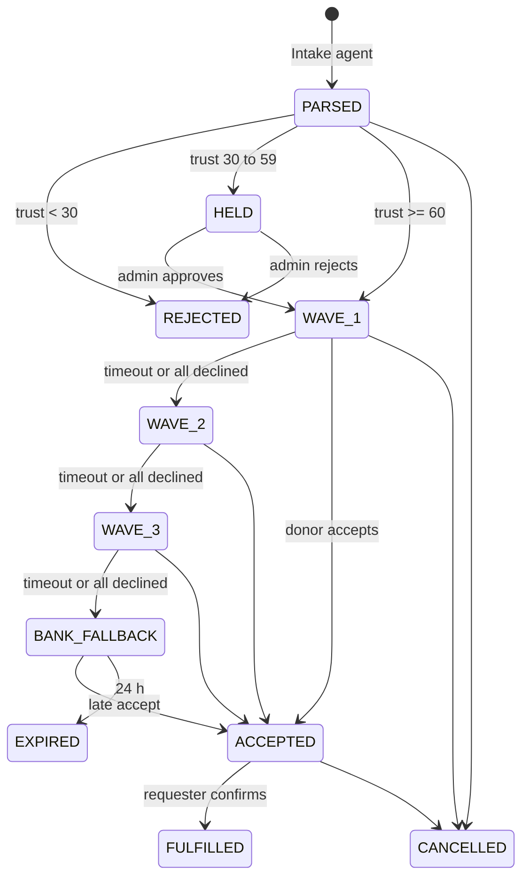

# Architecture

## Request lifecycle

A wave with no new eligible donors is skipped straight away. Donors from earlier waves can still accept while the request is open.

## Key design decisions

- **The LLM only handles language.** Eligibility, ranking and escalation are rules in `backend/app/rules.json`. That makes every decision reproducible in tests and explainable in the audit log.
- **State lives in the database.** Wave deadlines are columns, the worker polls for due deadlines, and the WebSocket re-reads the database. A restart loses nothing, and more than one server process can run.
- **One donor wins.** Accepting uses a conditional `UPDATE … WHERE status IN (searching)`, so two simultaneous accepts cannot both succeed.
- **Privacy by construction.** The map payload is built from a separate function that only includes a random label, rounded coordinates and status. Contact details appear only in `request_view` and only after acceptance.
